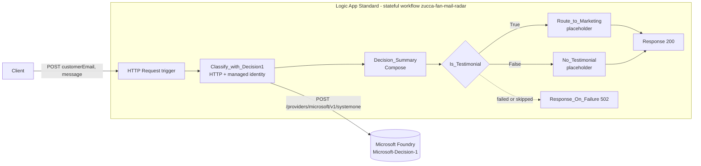

# Zucca Cat Treats Fan Mail Radar

An Azure Logic App (Standard) workflow that reads a customer message, asks the
**Microsoft-Decision-1** model in Microsoft Foundry a few typed questions about it, and
decides what to do next. The goal is to spot happy customers, shareable cat stories, and
new flavor requests.

> Zucca Cat Treats is a fictional brand. All test data in this repo is invented.

## Use case

A message like this comes in:

> "My tabby Biscuit figured out how to open the pantry door just to steal a bag of
> Salmon Crunch... Feel free to share this story with other cat parents!"

The workflow returns:

```json
{
  "product": "salmon_crunch",
  "happiness": "Superfan (2.00)",
  "shareable_story": "Yes (100%)",
  "share_permission": "Yes (100%)",
  "flavor_request": "none",
  "next_action": "Send to Marketing as testimonial"
}
```

Microsoft-Decision-1 is a decision model, not a chat model. It doesn't write text. It
returns typed answers with probabilities:

| Question | Type | What the model returns |
|---|---|---|
| `product` | choice | One of `salmon_crunch`, `tuna_bites`, `chicken_puffs`, `catnip_cookies`, `other` |
| `happiness` | score | 0 = Neutral, 1 = Happy, 2 = Superfan (can fall between levels) |
| `shareable_story` | noul | Probability (0 to 1) that the message has a fun or heartwarming cat story |
| `share_permission` | noul | Probability (0 to 1) that the customer clearly allows sharing |
| `flavor_request` | choice | One of `duck`, `turkey`, `shrimp`, `other`, `none` |

The workflow turns those into readable labels and a next action:

| Field | Rule |
|---|---|
| happiness | Neutral if score < 0.5, Happy if 0.5 to 1.5, Superfan if >= 1.5 |
| shareable_story | Yes if > 0.7 |
| share_permission | Yes if > 0.8 |
| next_action | **Send to Marketing as testimonial** if Superfan and shareable and permission; otherwise **Add vote to Flavor Wishlist** if a flavor was requested; otherwise **Send thank-you reply** |

## Architecture



- **No API keys.** The Logic App's system-assigned managed identity calls Foundry with
  audience `https://cognitiveservices.azure.com`. It has the **Cognitive Services User**
  role, scoped to the Foundry resource only.
- **No environment values in the workflow.** `workflow.json` reads the endpoint and
  deployment name from app settings: `@appsetting('FOUNDRY_ENDPOINT')` and
  `@appsetting('DECISION_DEPLOYMENT_NAME')`. `deploy.sh` sets them from your local `.env`.
- **Hosting:** a Logic App (Standard) on a Workflow Standard (WS1) App Service plan, with
  its own storage account.

## Repo layout

```
zucca-fan-mail-radar/workflow.json   the workflow definition
host.json                            Logic Apps runtime config (workflow extension bundle)
deploy.sh                            sets app settings and zip-deploys to your Logic App
test.sh                              sends test-data/messages.json, checks next_action and input validation
test-data/messages.json              fictional test messages with expected next actions
scan.sh                              pre-publish scan for secrets and your real environment values
.env.example                         every setting you need, as placeholders
```

## Deploy it in your own subscription

### Prerequisites

- Azure CLI 2.60 or later, signed in with `az login`
- `jq` and `zip`
- A Microsoft Foundry resource with a **Microsoft-Decision-1** deployment. See
  [Deploy and use Microsoft-Decision-1](https://learn.microsoft.com/azure/foundry/foundry-models/how-to/use-foundry-models-microsoft-decision).
- Permission to create resources and role assignments (for example Owner, or Contributor
  plus User Access Administrator)

### 1. Fill in `.env`

```bash
cp .env.example .env
```

Fill in your own values. Find your Foundry resource, endpoint, and deployment name with:

```bash
az cognitiveservices account list --query "[].{name:name, rg:resourceGroup, location:location, endpoint:properties.endpoint}" -o table
az cognitiveservices account deployment list -g <your-foundry-resource-group> -n <your-foundry-resource-name> -o table
```

Use the endpoint without a trailing `/`. Use the **deployment name** (not the model name)
for `DECISION_DEPLOYMENT_NAME`.

### 2. Create the Azure resources

This project runs on an **existing WS1 plan** and creates the Logic App and storage
account in that plan's resource group and region. Find a plan with:

```bash
az appservice plan list --query "[?sku.name=='WS1'].{name:name, rg:resourceGroup, location:location, apps:numberOfSites}" -o table
```

Pick a plan in the same region as your Foundry resource. If you don't have one, create
one with `az appservice plan create -g <rg> -n <name> -l <region> --sku WS1` (WS1 is billed
while it exists).

Then load `.env` and create the resources:

```bash
set -a; source .env; set +a

az storage account create -n "$STORAGE_ACCOUNT" -g "$RESOURCE_GROUP" -l "$LOCATION" \
  --sku Standard_LRS --kind StorageV2 --min-tls-version TLS1_2 --allow-blob-public-access false \
  --tags project=zucca-fan-mail-radar

az logicapp create -n "$LOGIC_APP_NAME" -g "$RESOURCE_GROUP" \
  --plan "$(az appservice plan show -g "$PLAN_RESOURCE_GROUP" -n "$PLAN_NAME" --query id -o tsv)" \
  --storage-account "$STORAGE_ACCOUNT" --functions-version 4 --https-only true \
  --disable-app-insights --tags project=zucca-fan-mail-radar

az webapp identity assign -n "$LOGIC_APP_NAME" -g "$RESOURCE_GROUP" --query principalId -o tsv
```

Put the printed principal ID in `.env` as `LOGIC_APP_PRINCIPAL_ID`.

The `project=zucca-fan-mail-radar` tag matters: `deploy.sh` refuses to deploy to any
Logic App without it, so a typo in `.env` can't overwrite another app on a shared plan.

### 3. Let the Logic App call Foundry

```bash
set -a; source .env; set +a

az role assignment create \
  --assignee-object-id "$LOGIC_APP_PRINCIPAL_ID" --assignee-principal-type ServicePrincipal \
  --role "Cognitive Services User" \
  --scope "$(az cognitiveservices account show -n "$FOUNDRY_RESOURCE_NAME" -g "$FOUNDRY_RESOURCE_GROUP" --query id -o tsv)"
```

The role can take a few minutes to take effect.

### 4. Deploy and test

```bash
./deploy.sh
./test.sh          # summary table with PASS/FAIL per message, plus 400 checks for invalid input
./test.sh --raw    # also prints each JSON response
```

`test.sh` fetches the trigger URL at run time. That URL contains a SAS signature
(`sig=`), so the script keeps it in memory only and passes it to curl through stdin. It's
never printed, logged, or written to disk. Treat it like a password if you fetch it
yourself.

## Clean up

The resource group is shared with other resources, so **don't delete the resource
group**. Delete only what this project created:

```bash
set -a; source .env; set +a

# 1. Remove the role assignment on the Foundry resource
az role assignment delete --assignee "$LOGIC_APP_PRINCIPAL_ID" --role "Cognitive Services User" \
  --scope "$(az cognitiveservices account show -n "$FOUNDRY_RESOURCE_NAME" -g "$FOUNDRY_RESOURCE_GROUP" --query id -o tsv)"

# 2. Delete the Logic App (this also removes its managed identity)
az logicapp delete -n "$LOGIC_APP_NAME" -g "$RESOURCE_GROUP"

# 3. Delete its storage account
az storage account delete -n "$STORAGE_ACCOUNT" -g "$RESOURCE_GROUP" --yes
```

Don't delete the WS1 plan if other apps use it. Check first with
`az appservice plan show -g "$PLAN_RESOURCE_GROUP" -n "$PLAN_NAME" --query numberOfSites`.

## Notes

- **Placeholders:** `Route_to_Marketing` and `No_Testimonial` are Compose placeholders.
  Replace them with real actions such as a Teams post, an email, or a queue message.
- **Thresholds are starting points.** Validate them on your own labeled messages before
  you automate anything.
- **Input validation:** the trigger uses `"operationOptions": "EnableSchemaValidation"`, and
  `message` has `minLength: 1`. An empty or missing `message` gets HTTP 400 before any run
  starts, so the model is never called. `test.sh` checks this.
- **Failure path:** if the Microsoft-Decision-1 call fails or times out, `Response_On_Failure`
  returns HTTP 502 with the model's status code.

## Production notes

- **Run history stores customer messages.** A stateful workflow keeps each run's inputs
  and outputs, including customer emails and message text. In production, turn on
  **secure inputs and outputs** for the `manual` trigger and the
  `Classify_with_Decision1` action, so this data is hidden in run history:

  ```json
  "runtimeConfiguration": {
    "secureData": { "properties": ["inputs", "outputs"] }
  }
  ```

  Secured values also flow to later actions that use them, such as `Decision_Summary`.
  Also set run history retention to match your privacy policy.
- **One secret lives in Azure:** `az logicapp create` stores the storage account
  connection string in the Logic App's `AzureWebJobsStorage` app setting. It stays in
  Azure and never in this repo. You can switch the runtime storage to managed identity.
- **Treat the trigger URL as a secret.** It contains a SAS signature. Rotate it by
  regenerating the access keys if it leaks. For production callers, consider putting
  API Management or Easy Auth in front of it.
- **AI decisions:** follow the
  [Microsoft-Decision-1 best practices](https://learn.microsoft.com/azure/foundry/foundry-models/how-to/use-foundry-models-microsoft-decision#best-practices).
  Keep a person in the loop before publishing any customer story.

## Before you publish a fork

Run the scan and gitleaks before every push:

```bash
./scan.sh                    # checks for GUIDs, non-example.com emails, SAS URLs, keys, and every value in your .env
gitleaks dir . --redact -v   # general secret scan
```

`scan.sh` reads your real values from `.env` at run time and reports matches by key name
only. Add other identifiers (your name, other resource names) to `SCAN_EXTRA_PATTERNS`
in `.env`.
