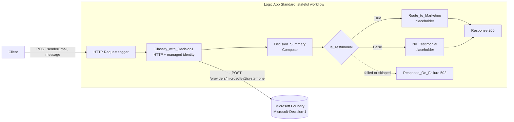

# Microsoft-Decision-1 in a Logic App workflow

A small Azure Logic App that sends fan mail to Microsoft-Decision-1 and routes each message based on the model's typed decisions.

## What is a decision model

Microsoft-Decision-1 does not write text. It picks from options you define and returns a probability for each one. It complements an LLM, it does not replace it: use it to classify, gate, or route, and use an LLM when you need to write a reply.

## What I found

I sent three fictional messages to a made-up cat treat brand, Zucca Cat Treats.

| Sender | Happiness | Shareable story | Permission to share | Next action |
|---|---|---|---|---|
| Mira | Superfan (2.00) | Yes (100%) | Yes (100%) | Send to Marketing as testimonial |
| Otto | Neutral (0.19) | No (0%) | No (0%) | Add vote to Flavor Wishlist |
| Juno | Superfan (1.91) | Yes (91%) | No (0%) | Send thank-you reply |

Juno's message is the interesting one. It is a cute story about a 17-year-old cat doing a happy dance for treats. The model rated it 91% shareable. But Juno asked us to keep it private, and the model rated permission at 0%. So the workflow did not send it to Marketing.

**Speed.** Warm runs took about 0.4 to 0.8 seconds for the whole workflow. The model call itself took about 0.2 seconds.

**Cost.** Each call used 275 to 364 input tokens and 5 output tokens. At $0.042 per million input tokens, with output free, 11 calls cost about $0.00015. That is less than two hundredths of a cent.

## How it works

The workflow asks the model five questions about each message in one call:

| Question | Type | What the model returns |
|---|---|---|
| `product` | choice | `salmon_crunch`, `tuna_bites`, `chicken_puffs`, `catnip_cookies`, or `other` |
| `happiness` | score | 0 = Neutral, 1 = Happy, 2 = Superfan. Can fall between levels. |
| `shareable_story` | noul | Probability that the message has a story worth sharing |
| `share_permission` | noul | Probability that the sender clearly allows sharing |
| `flavor_request` | choice | `duck`, `turkey`, `shrimp`, `other`, or `none` |

The rules that turn those answers into a next action:

- **Superfan** means a happiness score of 1.5 or more.
- **Shareable** means above 0.7. **Permission** means above 0.8.
- Superfan and shareable and permission: **Send to Marketing as testimonial**.
- Otherwise, if a flavor was requested: **Add vote to Flavor Wishlist**.
- Otherwise: **Send thank-you reply**.

The Logic App calls Foundry with its managed identity. There are no API keys. An empty or missing message gets HTTP 400 before the model is called.

## Try it yourself

1. Copy `.env.example` to `.env` and fill in your values.
2. Create a Logic App and storage account, and give the Logic App access to your Foundry resource.
3. Run `./deploy.sh`.
4. Run `./test.sh`.

[docs/SETUP.md](docs/SETUP.md) has every command, including cleanup. [docs/PRODUCTION.md](docs/PRODUCTION.md) covers privacy, secrets, and checks before you publish a fork.

All names, emails, and messages in this repo are fictional.
